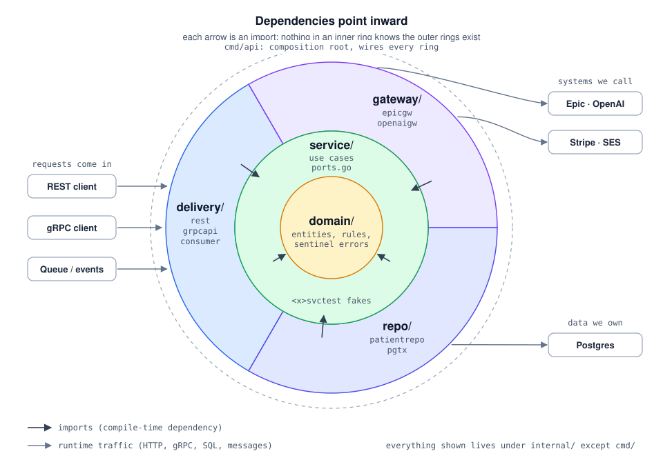
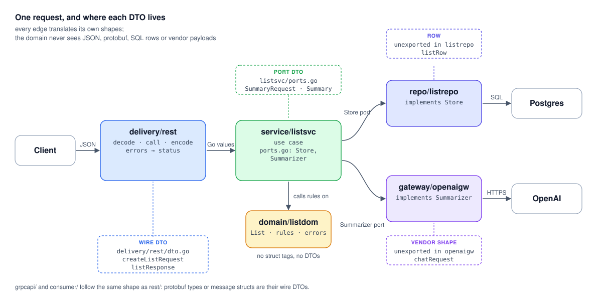

# code-taste-golang

A hexagonal-architecture (ports-and-adapters) playbook for Go backends — Domain / Repository / Service / Adapter / Unit-of-Work — written in idiomatic Go rather than ported from another language. Interfaces live with their consumers, constructors return structs, errors are values, `context.Context` comes first, and the layout follows [Organizing a Go module](https://go.dev/doc/modules/layout).

Inspired by [code-taste-python](https://github.com/rakeshbhugra/code-taste-python), which distils *Architecture Patterns with Python* (Cosmic Python). The concepts carry over; the shapes are Go's own.

It also ships as a [Claude Code Skill](https://code.claude.com/docs/en/skills) so Claude can review and structure Go code against these patterns automatically.

## What's in here

```
.
├── .claude-plugin/
│   └── marketplace.json                  # makes this installable as a plugin
├── docs/img/                             # architecture diagrams (hand-written SVG)
├── skills/
│   └── code-taste-golang/
│       ├── SKILL.md                      # the Claude Code skill entrypoint
│       └── docs/
│           ├── plan.md                   # reading plan: go.dev docs → stdlib source
│           └── architecture/             # the playbook
│               ├── README.md             # overview, dependency rule, vocabulary
│               ├── domain.md
│               ├── repository.md
│               ├── service.md
│               ├── adapter.md
│               ├── unit-of-work.md
│               ├── project-structure.md
│               ├── testing.md
│               ├── performance.md
│               ├── logging.md
│               ├── instrumentation.md
│               └── repository-harness.md # agent-ready repo practices
└── example/                              # runnable, stdlib-only reference module
    ├── AGENTS.md                         # entry map (CLAUDE.md symlinks here)
    ├── Makefile                          # make check = definition of done
    ├── go.mod
    ├── cmd/api/main.go                   # composition root
    ├── internal/
    │   ├── domain/listdom/               # domain: entities, rules, sentinel errors
    │   ├── service/listsvc/              # use cases; ports.go declares the interfaces
    │   │   └── listsvctest/              # fakes + contract suite for those ports
    │   ├── repo/listrepo/                # storage adapter (JSON file), passes the contract suite
    │   └── delivery/rest/                # REST entrypoint; wire DTOs in dto.go
    └── arch_test.go                      # enforces the dependency rule
```

## How a project should be structured

A multi-domain service (patients, EMR records, hospitals). The full walkthrough is in [project-structure.md](skills/code-taste-golang/docs/architecture/project-structure.md).

```
your-app/
├── AGENTS.md                          # entry map: overview, commands, hard rules (CLAUDE.md symlinks here)
├── Makefile                           # setup / test / lint / check — `make check` is the definition of done
├── go.mod
├── cmd/api/main.go                    # composition root: builds adapters, injects them into services
│
├── internal/                          # private to this module (enforced by the go tool)
│   ├── domain/                        # PURE: entities, rules, sentinel errors. Stdlib only, no I/O
│   │   ├── patientdom/                # package patientdom → patientdom.Patient, patientdom.ErrNotFound
│   │   ├── emrdom/                    # may import patientdom (one direction only)
│   │   └── hospitaldom/
│   │
│   ├── service/                       # USE CASES + PORTS
│   │   ├── patientsvc/
│   │   │   ├── ports.go               # every interface this service needs, plus port DTOs
│   │   │   ├── service.go             # Service + use-case methods
│   │   │   ├── service_test.go        # tests over the fakes below
│   │   │   └── patientsvctest/        # fakes for the ports + contract suite (like net/http/httptest)
│   │   ├── emrsvc/                    # ports.go: Encounters, Patients (own small view), EHRClient
│   │   └── hospitalsvc/
│   │
│   ├── repo/                          # STORAGE ADAPTERS: data the app owns
│   │   ├── patientrepo/               # implements patientsvc ports; runs patientsvctest's contract suite
│   │   │   └── rows.go                # persistence DTOs: unexported row structs ↔ domain
│   │   ├── emrrepo/
│   │   ├── hospitalrepo/
│   │   └── pgtx/                      # one *sql.Tx across domains; migrations/ embedded here
│   │
│   ├── gateway/                       # GATEWAYS: third-party systems the app calls, one package per vendor
│   │   ├── epicgw/                    # implements emrsvc.EHRClient; Epic's JSON shapes unexported here
│   │   └── openaigw/
│   │
│   └── delivery/                      # ENTRYPOINTS: how requests reach the app; no business rules
│       ├── rest/
│       │   ├── rest.go                # routes, handlers, error → status
│       │   └── dto.go                 # WIRE DTOs: JSON request/response structs
│       ├── grpcapi/                   # gRPC server; generated protobuf types are its wire DTOs
│       └── consumer/                  # queue/event consumers; message DTOs in dto.go
│
├── arch_test.go                       # enforces the dependency rule, with WHY/FIX messages
└── docs/adr/                          # one short file per decision, including rejected alternatives
```

**Dependency rule.** Imports only point inward:

```
domain/<x>dom  ←  service/<x>svc  ←  repo/* · gateway/* · delivery/*  ←  cmd/api
                        └── <x>svctest (fakes): imported from _test.go files only
```

Services never import other services. `arch_test.go` fails the build on any other edge.



## Design choices

**1. Layers are folders, and domains are subfolders.** `domain/`, `service/`, `repo/`, `gateway/` and `delivery/` make the architecture visible from the file tree. Each domain gets its own subfolder in every layer, so all the code for a domain is easy to find.

**2. Every package carries a layer suffix: `patientdom`, `patientsvc`, `patientrepo`.** In Go a folder is a package, and its name prefixes every identifier the package exports. With the suffix, all three layers can be imported side by side without aliases, and every call site says which layer it touches (`patientdom.ErrNotFound`, `patientsvc.New`, `patientrepo.New(tx)`). The folder name always matches the package name.

**3. Interfaces (ports) are declared in the service that uses them, in `ports.go`.** A Go type satisfies an interface just by having the right methods, so the adapter never needs to import or name the interface. The Go convention is that the consumer declares it. One `ports.go` per service keeps every seam in a predictable place, without a shared `ports` package that would invite import cycles.

**4. Services never import other services.** When `emrsvc` needs patient data, it declares a small `Patients` interface in its own `ports.go`, and `patientrepo` satisfies it. Use cases stay flat, and services can't form import cycles.

**5. Adapters split three ways: `repo/`, `gateway/`, `delivery/`.** `repo/` holds data the app owns: schemas it migrates and transactions it controls. `gateway/` holds systems it calls, such as Epic, OpenAI or Stripe; the name is Fowler's Gateway pattern, and each package carries a `gw` suffix (`openaigw`) so it never collides with the vendor's SDK package. `delivery/` holds the ways requests reach the app, one package per transport (`rest`, `grpcapi`, `consumer`). All three stay under `internal/`: in Go that folder is a visibility rule, not a "core only" marker, and moving adapters out would publish them as API. Repos and gateways fail differently, are tested differently and change for different reasons. Repos are per domain. When one use case must write several domains atomically, `pgtx` opens a single transaction and builds every repo on it.

**6. Fakes live beside the ports, in `<x>svctest`, not beside the adapters.** A fake imitates the port, not the vendor: `FakeEHR` stands in for `emrsvc.EHRClient`, not for Epic. The standard library uses the same pattern (`net/http/httptest`, `testing/fstest`). Each `<x>svctest` also ships a contract suite that both the fake and the real adapter must pass, so service tests can never pass against a fake that behaves differently from production.

**7. DTOs live at the edge that speaks them, and the domain has none.**

| DTO | Lives in | Example |
|---|---|---|
| Wire (API request/response) | the delivery package: `delivery/rest/dto.go` (JSON), protobuf types in `delivery/grpcapi`, `delivery/consumer/dto.go` (messages) | `createListRequest`, `listResponse` |
| Port (data exchanged with an outside system) | the service's `ports.go` | `SummaryRequest`, `ChargeResult` |
| Vendor wire shapes | unexported, inside the gateway package | `chatRequest` in `openaigw` |
| Persistence rows | unexported, inside the repo package | `listRow` in `listrepo` |

Domain types carry no struct tags. The API contract, the vendor's format and the database schema each change for their own reasons, and none of those changes should touch business rules.



**8. `cmd/api/main.go` is the only place that knows concrete types.** It reads config, builds adapters, injects them into services and starts the server. Wiring is plain Go with no DI framework, so the compiler checks every connection.

**9. Tests sit beside the code they test.** `go test` requires it. The test pyramid follows the layers: table-driven unit tests in `domain/`, service tests over fakes in `service/`, contract and integration tests in `repo/` and `gateway/`, and end-to-end tests through `httptest` in `delivery/rest/`.

**10. The rules are enforced, not just documented.** Go refuses to compile import cycles, `internal/` hides everything from other modules, and `arch_test.go` checks every remaining edge. When a check fails, it prints a WHY line and a FIX line.

### Mapping from a layered Python or Java codebase

| Familiar layout | Here |
|---|---|
| `domain/` | `internal/domain/<x>dom/` |
| `services/` | `internal/service/<x>svc/` |
| `ports/` (abstract base classes) | `ports.go` inside each service (choice 3) |
| `adapters/repositories/` | `internal/repo/` |
| `adapters/<vendor>/` | `internal/gateway/<vendor>gw/` (choice 5) |
| `adapters/*/fake.py`, mocks | `internal/service/<x>svc/<x>svctest/` (choice 6) |
| `entrypoints/api/` + `schemas/` | `internal/delivery/rest/` + `dto.go` (choice 7) |
| `bootstrap.py` / DI container | `cmd/api/main.go` (choice 8) |
| `tests/unit/`, `tests/integration/` … | `_test.go` beside each file (choice 9) |

[`example/`](example/) is a working, stdlib-only version of this layout.

## Run the example

Requires Go 1.24+.

```bash
cd example
make check      # what CI runs
make run
# in another shell
curl -s -XPOST localhost:8080/lists -d '{"owner":"u1","name":"My Stuff"}'
```

## Install as a Claude Code skill

### Option 1 — Plugin marketplace (recommended)

Inside Claude Code:

```
/plugin marketplace add vsheshjain/code-taste-golang
/plugin install code-taste-golang@code-taste-golang
/reload-plugins
```

Update with `/plugin marketplace update code-taste-golang` followed by `/reload-plugins`.

### Option 2 — Manual git clone

```bash
git clone https://github.com/vsheshjain/code-taste-golang.git
ln -s "$(pwd)/code-taste-golang/skills/code-taste-golang" ~/.claude/skills/code-taste-golang
```

Claude Code auto-discovers skills in `~/.claude/skills/`. Update with `git pull`; uninstall by removing the symlink.

### Verify

In Claude Code, ask:

> review this Go package against the code-taste architecture

If the skill loaded, Claude will pull the relevant doc(s) from `skills/code-taste-golang/docs/architecture/` and review against the dependency rule and Go-specific traps.

## Use the docs without the skill

Start at `skills/code-taste-golang/docs/architecture/README.md` — it's the entry point and explains the dependency rule and vocabulary used by the rest.

## References

- [Effective Go](https://go.dev/doc/effective_go)
- [Go Code Review Comments](https://go.dev/wiki/CodeReviewComments)
- [Organizing a Go module](https://go.dev/doc/modules/layout)
- [Package names](https://go.dev/blog/package-names)
- [Working with errors in Go 1.13](https://go.dev/blog/go1.13-errors)
- [Contexts and structs](https://go.dev/blog/context-and-structs)
- [Structured logging with slog](https://go.dev/blog/slog)
- *Architecture Patterns with Python* — Harry Percival & Bob Gregory (O'Reilly), the source of the concepts
