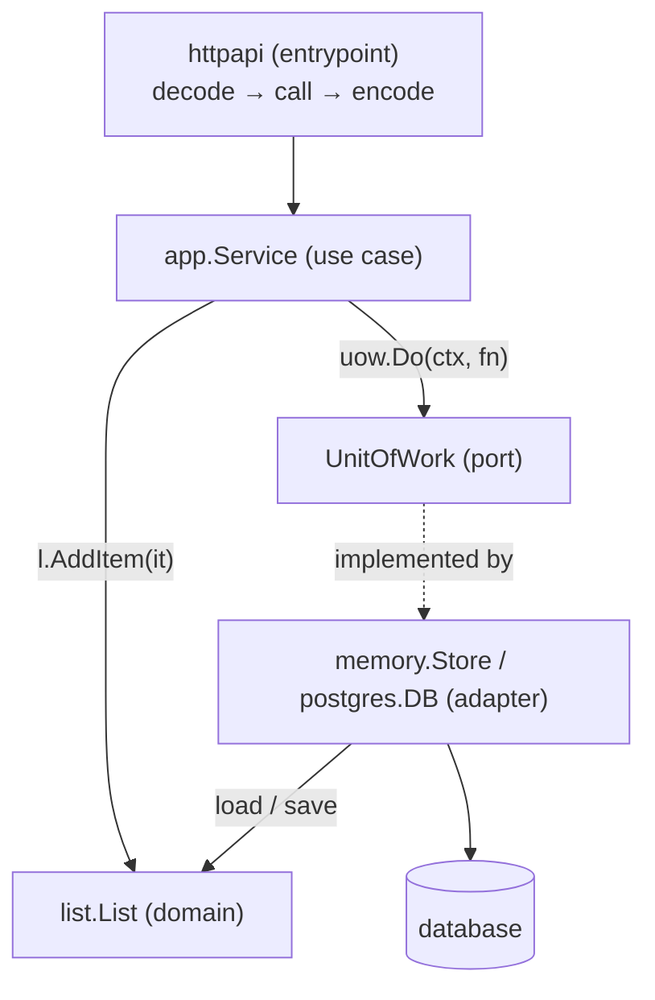
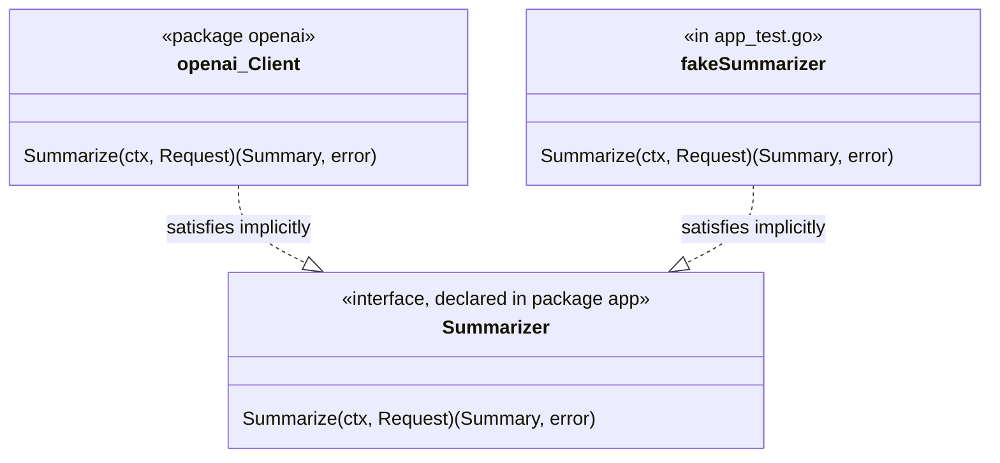

# Architecture Concepts (Go)

A working glossary of the terms from *Architecture Patterns with Python* (Cosmic Python), DDD, and hexagonal architecture — translated into idiomatic Go. Taught in dependency order: each concept builds on the previous.

The patterns are language-neutral. The *shapes* are not. Go has no classes, no inheritance, no abstract base types, and no exceptions; it has packages, structs, implicitly-satisfied interfaces, and errors as values. Those four facts change how every pattern below is written, and this playbook leans on them instead of fighting them.

Primary references (read alongside): [Effective Go](https://go.dev/doc/effective_go), [Go Code Review Comments](https://go.dev/wiki/CodeReviewComments), [Organizing a Go module](https://go.dev/doc/modules/layout), [Package names](https://go.dev/blog/package-names).

A runnable, stdlib-only module that applies everything here lives at [`example/`](../../../../example/). Run `go test -race ./...` inside it.

## Quick-reference diagram

### Runtime flow — what calls what



**How to read it:** a request comes in at the top, drops into a service method, the service opens a unit of work and calls methods on the domain. The unit of work hands the service repositories (adapters) that load and save domain values. Adapters talk to external systems. Nothing below ever imports anything above it.

### Port and adapter, the Go way



The **port is the shape of the hole; the adapter is the plug.** Two Go-specific twists:

1. **The port lives with its consumer**, not with its implementation. `app` says "I need something that can `Summarize`"; `openai` never mentions `app.Summarizer` at all. Go interfaces are satisfied implicitly, so the adapter doesn't need to import the port. ([Code Review Comments: Interfaces](https://go.dev/wiki/CodeReviewComments#interfaces))
2. **Constructors return concrete types.** `openai.New(...)` returns `*openai.Client`, not `app.Summarizer`. The conversion to the interface happens at the call site in `main`. *"Accept interfaces, return structs."*

### The dependency rule (the only thing you must get right)

```
internal/list        ←  imports stdlib only            (domain)
internal/app         ←  imports list                   (use cases + the interfaces they need)
internal/postgres    ←  imports list, app, SQL driver  (adapter)
internal/httpapi     ←  imports app, list              (entrypoint)
cmd/api              ←  imports everything             (the wiring — "bootstrap")
```

Arrows always point **inward toward the domain**. Go gives you two enforcement tools for free:

- **Import cycles don't compile.** If `list` imports `app` while `app` imports `list`, the build fails. Most violations die here.
- **`internal/` is private to the module.** Nothing outside your module can import your domain or adapters. ([`go` command: internal directories](https://go.dev/cmd/go#hdr-Internal_Directories))

The violations a compiler can't see (one adapter importing another, an adapter importing an entrypoint) are caught by a ten-line test over `go list -deps` — see [`example/arch_test.go`](../../../../example/arch_test.go).

## Reading order — the core five

1. [Domain](./domain.md) — what your app is fundamentally about: structs, methods, sentinel errors
2. [Repository](./repository.md) — the one place that knows how to load and save domain values
3. [Service](./service.md) — the method that runs one use case from start to finish
4. [Adapter](./adapter.md) — the generalization of Repository to any external system, and where Go interfaces belong
5. [Unit of Work](./unit-of-work.md) — the transaction boundary, written as a closure

### Putting it on disk

- [Project Structure](./project-structure.md) — `go.mod`, `cmd/`, `internal/`, package naming, what the layout looks like once you apply the core five
- [Testing](./testing.md) — `go test`, table-driven tests, hand-written fakes, `httptest`, race detector, fuzzing
- [Performance & Benchmarking](./performance.md) — pprof, execution traces, benchmarks + benchstat, load tests, the prod failure modes
- [Code-Level Instrumentation](./instrumentation.md) — OpenTelemetry spans, metrics, health checks, latency budgets
- [Logging & Observability](./logging.md) — `log/slog`, request IDs through `context`, what to log and never log

### Why this order

- **Repository** only makes sense once you know what a *Domain* is.
- **Service** only makes sense once you have a Domain *and* a Repository.
- **Adapter** is a generalization of Repository — easier once you've seen one.
- **Unit of Work** ties Services and Repositories together at transaction boundaries.

## After the core five

The remaining Part I chapters of the book are worth reading even though the code is Python — the ideas port cleanly:

6. **Coupling and Abstractions** (ch. 3) — *"Depend on abstractions you control."* In Go this reads as: define small interfaces at the consumer, in your own vocabulary.
7. **TDD in High Gear and Low Gear** (ch. 5) — the test pyramid for layered apps.
8. **Aggregates and Consistency Boundaries** (ch. 7) — one repository per aggregate, not per table.

Part II (events, message bus, CQRS) is intentionally skipped. Most services don't need it until they have multiple services or hard read/write asymmetry.

## Vocabulary cheat-sheet

| Term | Plain English | Go shape |
|---|---|---|
| **Domain** | What your app is fundamentally about, in business terms | A package (`internal/list`) |
| **Entity** | A thing with identity that changes over time | A struct with an `ID` field and pointer-receiver methods |
| **Value object** | A thing defined by its values | A small comparable struct, passed by value (`list.Item`) |
| **Aggregate root** | The entity in charge of a cluster | The struct the repository returns (`*list.List`) |
| **Domain error** | A named business failure | Sentinel `var ErrFull = errors.New(...)`, matched with `errors.Is` |
| **Persistence ignorance** | The domain doesn't know how it's stored | Domain structs carry no `json`/`db` tags and import no drivers |
| **Repository** | Collection-shaped access to storage | A small interface: `Get(ctx, id)`, `Save(ctx, v)` |
| **Application service** | A use case: load → delegate → save | A method on `app.Service` taking `ctx` first |
| **Port** | An interface the core depends on | An interface declared in the *consuming* package |
| **Adapter** | A concrete implementation of a port | A package named after the tech (`postgres`, `stripe`) returning a concrete struct |
| **Unit of Work** | Owns one transaction | `Do(ctx, func(Repos) error) error` — nil commits, error rolls back |
| **Composition root** | Where concrete types are chosen and wired | `func main()` / `run()` in `cmd/<binary>` |
| **Hexagonal / Ports-and-Adapters / Clean / Onion** | Domain in the middle, infrastructure outside, dependencies inward | All the same idea |
| **Anemic domain model** | Structs with fields only, all logic in services | Common in Go codebases; a smell when the domain has real rules |

## How each doc is structured

1. **One-line definition**
2. **What it looks like in Go** — anchored to the [`example/`](../../../../example/) module
3. **What's in / what's out**
4. **The traps** — including the ones Go programmers coming from Java or Python fall into
5. **How to spot it in your code**
6. **Self-check**
7. **Things to steal**
